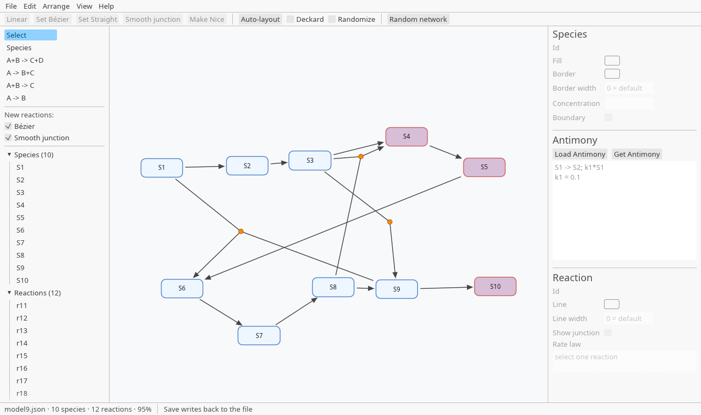
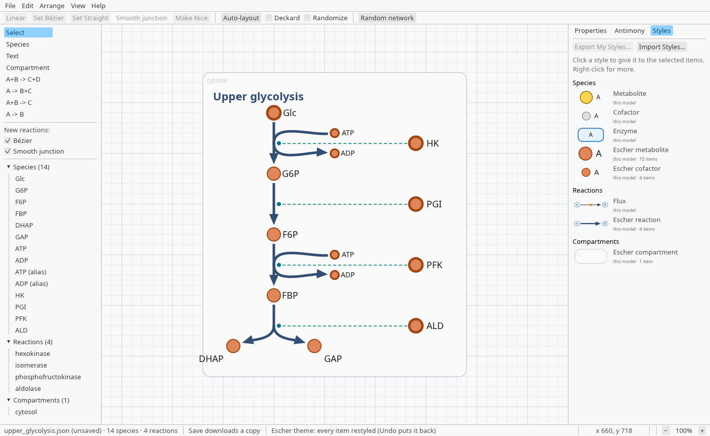
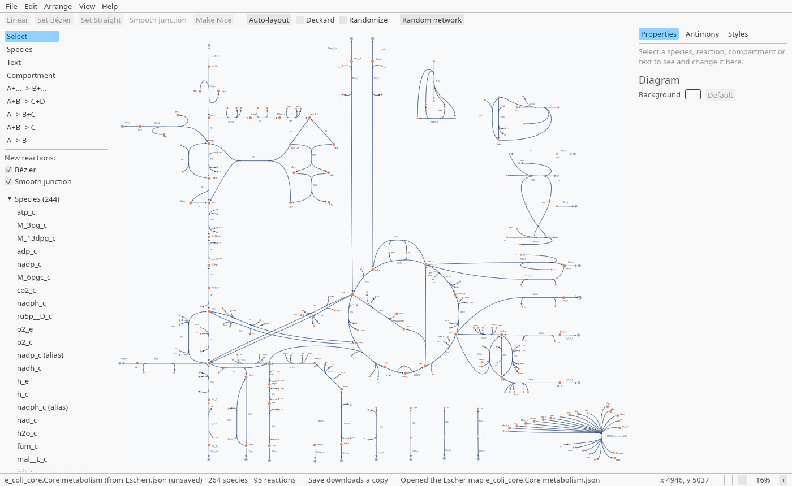

# PathwayDesigner

A drawing tool for biochemical reaction networks. Draw species and reactions,
shape the reactions with straight lines or Bézier curves, give them rate laws,
lay the network out automatically, and exchange it with the rest of the systems
biology world as Antimony or SBML with layout.

It is written in Rust with [egui](https://github.com/emilk/egui). The same code
runs in the browser and as a desktop app for Windows, macOS and Linux.

This was developed with the assistance of claude. Stop here if you aren't comfortable with AI assisted code generation.

**Try it:** https://sys-bio.github.io/PathwayDesigner-rs/



The same model in the Escher theme (*View ▸ Theme ▸ Escher*), for metabolic maps:



An [Escher](https://escher.github.io) map of *E. coli* core metabolism, opened
with *File ▸ Open* (`Escher/e_coli_core.Core metabolism.json`) and drawn as Escher
draws it:



This is a re-implementation of the Delphi PathwayDesigner. It does everything the
Delphi version does, and some more (see [Status](#status)).

## Get it

- **In the browser:** open https://sys-bio.github.io/PathwayDesigner-rs/. Nothing
  to install, and it keeps working offline once it has been opened.
- **On the desktop:** download the installer for Windows, macOS or Linux from
  [Releases](https://github.com/sys-bio/PathwayDesigner-rs/releases). The packages
  are not signed, so the first time you start it, Windows asks you to choose
  *More info ▸ Run anyway*, and on macOS you right-click the app and choose *Open*.
- **On your own web server:** copy the website, a folder of plain files, as
  described in [Host your own copy](#host-your-own-copy).

## Features

**Drawing and editing**
- Species, and reactions of any shape, with stoichiometry: tools for A → B,
  A + B → C, A → B + C and A + B → C + D, and **A+… → B+…** for any number of
  reactants and products (click the reactants, press Enter, click the products,
  press Enter again).
- Change a reaction's species afterwards from its right-click menu: **Add
  Reactant…**, **Add Product…** and **Remove from Reaction**. An automatic rate
  law follows, and a side left empty gets a null node.
- Three ways to draw a reaction: **Straight** (legs meet at a junction), **Linear**
  (one straight line, for A → B), and **Bézier** curves with handles you can drag,
  optionally with a smooth junction. A reaction can also have a **stem**, a
  straight centre line its reactants join at one end and its products leave from
  the other, as Escher draws reactions.
- **Aliases** (a second drawing of the same species), with commands to split a
  species into aliases, split off chosen reactions, and merge aliases back.
- **Modifiers** (drawn as dashed arcs, found from the rate law), and **null
  nodes** for sources and sinks. A modifier can be an **activator** (open
  arrowhead), **inhibitor** (blunt bar) or **catalyst** (open circle), carried to
  and from SBML (as SBO terms) and Antimony (in the diagram comment). Modifier lines, and reactants' and
  products' lines, can be routed round the diagram through **corner points**,
  carried in SBML Layout as curves of several segments.
- **Compartments**, drawn as boxes you can move and resize; species move with
  their compartment, a box can be hidden, and its name can be any size.
- **Free text** for titles and notes, with typeface, size, bold, italic, colour,
  alignment and wrapping.
- A right-hand panel with **Properties** for what is selected (colours, line and
  border widths, values, boundary species, rate laws, with errors in a rate law
  shown as you type), the live **Antimony** text, and the saved **Styles**.
- A model tree listing every species, reaction and compartment, usable from the
  keyboard.
- Undo and redo for every change.

**How things look**
- Species **shapes**: rounded rectangle, rectangle, ellipse, circle or hexagon;
  **resize** them by their corners or by number, or fit them to their names.
- Fill, border colour, border width (0 for no border), solid or dashed border,
  label colour and font size, for each item. A species' or compartment's fill can
  be left out (**No fill**), so what is behind shows through.
- The diagram's **background colour** (Properties, with nothing selected), on
  screen and in exported pictures.
- **Names outside the node**, as in Escher's metabolic maps: small circles with
  their names beside them, each name dragged where you want it.
- **Reaction names**: show a reaction's id beside it (*Show Id* in the
  Properties panel), placed clear of its lines, with its own size and colour;
  drag it where you want it.
- **Copy Style** and **Paste Style** (Ctrl+Alt+C, Ctrl+Alt+V) copy a look from one
  item to others, like a format painter; an alias can take its species' look.
- **Saved styles**: keep a look under a name and give it to other items, which then
  follow it, so changing the style changes them all. Styles are kept with the app
  ("My Styles") and saved in the model file for the styles it uses, so a model
  given to someone else carries them. Edit a style directly, and export and import
  styles to share them.
- **Themes** (*View ▸ Theme*): **Escher** restyles the whole diagram as a metabolic
  map, with orange circles, smaller circles for cofactors such as ATP and NADH,
  names placed clear of the lines, thick blue reactions curving smoothly
  through their junctions, and every reaction's name shown; new items follow
  the theme. **Classic** puts back the default look. Undo reverses either.
- Arrowheads grow with thick reaction lines.

**Layout**
- Force-directed **auto-layout**, animated, with an optional pass that shapes the
  Bézier curves. Locked nodes stay where they are.
- **Align and distribute** species and junctions, and **Arrange in Circle**.
- A **grid** to line things up, and **Snap to grid**: dragged items, new items,
  corners, Bézier handles, names and arrow-key moves land on grid points (hold Alt
  to place freely).
- Nudge the selection with the arrow keys.
- The pointer's position on the diagram is shown in the status bar.
- A random network generator, for trying things out.

**Files**
- PathwayDesigner's own JSON format. It reads the Delphi version's files, and a
  model that uses nothing new is still saved in the Delphi version's format.
- **Antimony**: import and export, with a live Antimony panel next to the drawing.
  The drawing goes with it, in a readable diagram format written as a comment
  after the model ([docs/diagram-format.md](docs/diagram-format.md)), so any
  Antimony tool still reads the file: File ▸ Export Antimony writes it, and the
  panel's Get Antimony does with *Diagram* ticked. File ▸ Export Antimony with
  Layout Statements, or *Layout statements* in the panel, adds Antimony 3's own
  layout statements, for tellurium and SBMLNetwork. Import reads either, from PathwayDesigner or from
  libAntimony, and lays out what a diagram leaves out.
- **SBML** Level 2 and Level 3: import and export, including the **Layout**
  package, so positions, aliases, curves, reaction stems and reaction names survive
  the round trip, and the **Render** package, so colours, line widths, dashes,
  shapes, fonts, arrowheads and modifier symbols do too. Other tools draw the
  file in PathwayDesigner's look (checked with COPASI and SBMLNetwork), and the
  Render that COPASI, SBMLNetwork and SBMLDiagrams write is read, with a
  warning for anything that can only be approximated
  ([docs/render-design.md](docs/render-design.md)).
- **Escher maps**: *File ▸ Open* reads an [Escher](https://escher.github.io) map
  (`.json`) and draws it as Escher does: its layout, each reaction's straight
  centre line and the map's own curves, its labels, and each extra drawing of a
  metabolite as an alias, in the Escher theme, each at the size the map gives it.
  Maps whose lines are routed through chains of markers (such as the BiGG maps
  drawn by MetaCarto) keep their routes as corner points.
- **KEGG maps**: *File ▸ Open* reads a [KEGG](https://www.kegg.jp) metabolic
  pathway map (a KGML file, `.xml`) at KEGG's positions: compounds as circles,
  enzymes as boxes catalysing their reactions, links to other maps as grey text.
  Compounds are labelled with names from [PubChem](https://pubchem.ncbi.nlm.nih.gov)
  (*D-Glucose*, not `C00031`), as display names; the KEGG numbers stay their ids. On the desktop, *File ▸ Open from KEGG…* fetches a
  map by its code (`eco00010`); KEGG doesn't let web pages fetch its files, so in
  the browser the map's file opens in a new tab, to be saved and opened. KGML
  gives no line routes, so reactions whose compounds don't line up are drawn as
  rounded elbows. Signalling and global maps aren't read yet. KEGG's data are
  free for academic use under [KEGG's terms](https://www.kegg.jp/kegg/legal.html)
  ([docs/kegg-import-design.md](docs/kegg-import-design.md)).
- **Network structure** (the *Structure* tab): the stoichiometry matrix (in a
  panel under the diagram), the flux null space and the conservation laws, computed
  as COPASI does (QR with column pivoting) and checked against libRoadRunner, with
  an optional sparse basis whose vectors are short routes. Clicking a vector or a law
  highlights it on the network; Copy and CSV export for each.
- **Graphics**: SVG, PNG at any resolution, and vector PDF (Letter, A4 or the
  drawing's own size), and printing.
- **The Gallery**: *File ▸ Open from Gallery…* opens example models, from small
  networks to *E. coli* central metabolism and Escher's *E. coli* core map. They
  are fetched from this repository when wanted, so new ones appear without a new
  release (see [The Gallery](#the-gallery)).

**In the browser**
- Works offline once it has been opened. Saves straight back to the file you
  opened (in Chromium-based browsers), autosaves, and offers your changes back if
  the tab was closed or the app crashed.
- Says when a new version has been published.

**On the desktop**
- Opens files from the file manager, and keeps a list of recent files.
- Autosaves every 10 seconds while there are unsaved changes, and offers them back
  after a crash or a power cut.
- On macOS, the usual application menu (About, Settings, Hide, Quit) and Window
  menu, and Cmd for every shortcut.

## Getting started

Pick a tool on the left: **Species** adds a species where you click, and the
reaction tools (A → B and the others) add a reaction when you click its species in
turn; with **A+… → B+…**, press Enter after the reactants and again after the
products. **Select** is for selecting, dragging and editing. Esc goes back to Select.

The toolbar shapes the selected reactions (Linear, Bézier, Straight, smooth
junction, Make Nice) and runs the auto-layout. Right-click a species or a reaction
for more: aliases, renaming, locking, alignment, styles. The View menu has the
grid, Snap to grid, zoom, and switches for the alias indicator and modifier
lines.

## Mouse and keyboard

On macOS, Cmd takes the place of Ctrl and Option of Alt.

**On the canvas, with the Select tool**

| Action | What it does |
|---|---|
| Click | Select a species, reaction, compartment, text or name |
| Shift-click | Add to or take from the selection |
| Drag on empty canvas | Select everything the rectangle touches |
| Drag a species, junction, text, name or compartment border | Move it (a compartment carries what is inside it) |
| Drag a Bézier handle of a selected reaction | Reshape that line |
| Drag a corner of a selected species or compartment | Resize it; Shift keeps the proportions |
| Drag the small handle on a selected text's right edge | Set where its lines wrap |
| Drag a square at an end of a selected reaction's stem | Move that end of the stem; with *Straight stem* ticked (Properties), the stem pivots about the junction instead of bending |
| Drag the **+** by a selected reaction's junction onto a species | Add the species to the reaction as a product; hold Shift when letting go for a reactant |
| Alt while dragging | Place freely while Snap to grid is on |
| Double-click a species | Rename it |
| Double-click a text | Edit its words |
| Double-click a modifier line, or a reactant's or product's line | Add a corner point there, so the line can turn a corner; drag the small square to move it, right-click it to remove it |
| Right-click | The menu for what is under the pointer (aliases, Add Reactant…, Add Product…, Remove from Reaction, Add, Straighten or Remove Stem, Modifier Kind, corner points, styles, alignment, locking and more) |
| Rest the pointer on an item | A tooltip: a species' value, a reaction's rate law, a compartment's volume |

**Adding things**

| Tool or command | How |
|---|---|
| Species, Text | Click where it should go |
| Compartment | Drag out its box (a click makes a 300 × 200 box) |
| A → B, A + B → C, A → B + C, A + B → C + D | Click the reactants, then the products, in turn |
| A+… → B+… | Click the reactants, press Enter, click the products, press Enter again |
| Add Reactant…, Add Product… (a reaction's right-click menu) | Click species to add them; Esc or a click on empty canvas stops |
| Any of these | A click on empty canvas, or Esc, cancels |

**Getting around**

| Action | What it does |
|---|---|
| Wheel, or two-finger scroll | Pan (Shift: sideways) |
| Ctrl + wheel, or pinch | Zoom, keeping the point under the pointer still |
| Middle-button drag, or Space + drag | Pan |
| The − / % / + at the right of the status bar | Zoom out, zoom to fit, zoom in |

**In the model tree (left)**

| Action | What it does |
|---|---|
| Click | Select that item |
| Ctrl-click | Add to or take from the selection |
| Shift-click | Select everything from the last item clicked |
| ↑ / ↓, Shift + ↑ / ↓ | Move through the list; extend the selection |

**Keys**

| Keys | What they do |
|---|---|
| Ctrl+Z | Undo |
| Ctrl+Shift+Z, Ctrl+Y | Redo |
| Ctrl+A | Select all (Edit also has Select All Species and Select All Reactions) |
| Delete, Backspace | Delete the selection |
| Arrow keys, Shift + arrow keys | Nudge the selection 1 unit, 10 units; with Snap to grid, one grid line, five (Alt for 1 and 10) |
| Arrow keys after clicking a corner point | Move that point instead, by the same steps; a click elsewhere or Esc goes back to the selection |
| Ctrl+Alt+C, Ctrl+Alt+V | Copy Style, Paste Style |
| Enter | With A+… → B+…: on to the products, then make the reaction |
| Esc | Cancel what is in progress (a drag, a reaction being picked, a layout) and go back to the Select tool |
| Ctrl+S, Ctrl+Shift+S | Save, Save As |
| Ctrl+O | Open |
| Ctrl+N | New (in a browser, Ctrl+N opens a new browser window: use File ▸ New) |

## File formats

| Format | Extension | Read | Write |
|---|---|---|---|
| PathwayDesigner diagram | `.json` | yes | yes |
| Antimony | `.ant`, `.txt` | yes | yes |
| SBML Level 2 and 3, with Layout and Render | `.xml` | yes | Level 3 Version 1 |
| Escher map | `.json` | yes | |
| SVG, PNG, PDF | `.svg`, `.png`, `.pdf` | | yes |

`Models/` holds the reference models in each format. The tests check every one,
so a model added there needs a stored image. File ▸ Open sample opens the JSON
ones directly, even in the browser. `ExampleModels/` holds more example models;
the tests don't use it. `Escher/` holds an Escher map of *E. coli* core metabolism.
Both are in the Gallery.

## The Gallery

*File ▸ Open from Gallery…* lists the example models named in
[`Gallery/index.json`](Gallery/index.json) and opens the one you pick. The app
reads the list and the files from this repository's `main` branch on GitHub, in
the browser and on the desktop, so a model added or changed here reaches every
copy of the app once it is pushed: no new build or release. GitHub caches the
files for a few minutes, so a change can take about five minutes to show. With
no network the window says so; *File ▸ Open sample* still has a few models built
into the app.

To add a model:

1. Put the file anywhere in the repository; `ExampleModels/` is the usual place.
   It can be a PathwayDesigner `.json` file or an Escher map.
2. Add an entry to `Gallery/index.json`:

   ```json
   {
     "file": "ExampleModels/my_model.json",
     "group": "Large models",
     "title": "My model",
     "description": "One line about it",
     "version": 4
   }
   ```

   - `file`: the path from the repository's root.
   - `group`: the heading it is listed under. Groups appear in the order they
     first appear in the file; a new name makes a new group.
   - `title`, and an optional `description` shown under it.
   - `version`: the `"version"` at the top of the model's file, or `0` for an
     Escher map. An app too old for that version shows the entry greyed out
     instead of failing to open it.
3. Run `cargo test -p pd-app gallery`. It checks every entry: the file exists,
   opens, and has the version the entry says, and no file is listed twice. CI
   runs the same test, so a mistake fails the push that makes it.
4. Commit and push to `main`.

Changing a model is just steps 3 and 4, and step 2 if its version changed (saving
it in a newer app can raise it). To remove one, delete its entry.

To try a Gallery before pushing it, build the app with `PD_GALLERY_URL` set to
another address that serves the same files, ending in `/`, for example
`PD_GALLERY_URL=http://127.0.0.1:8080/ trunk serve` from `crates/pd-app` with the
repository served on port 8080.

## Project layout

| Crate | What it is |
|---|---|
| [`pd-core`](crates/pd-core) | The model, geometry, drawing, interaction, undo, layout, and the JSON, Antimony and SBML bridges. No user interface or platform code, so all of it is tested without a window. |
| [`pd-app`](crates/pd-app) | The egui application, for the browser and the desktop. |
| [`pd-export`](crates/pd-export) | Graphics output: SVG, PNG (through resvg) and PDF. |
| [`antimony`](crates/antimony) | Reads and writes Antimony, all of the language, and converts it to SBML. Written to be reusable on its own, and checked case by case against a complete reference implementation. See its [README](crates/antimony/README.md). |
| [`sbml-io`](crates/sbml-io) | Reads and writes SBML as plain Rust data. Written to be reusable on its own: Level 2 and 3 core plus Layout and Render, pure Rust, with everything it doesn't understand kept for a lossless round trip. See its [README](crates/sbml-io/README.md). |

## Building and testing

You need [Rust](https://rustup.rs/), the `wasm32-unknown-unknown` target
(`rustup target add wasm32-unknown-unknown`) and [Trunk](https://trunkrs.dev/).

```
cargo test --workspace                # the tests
cargo run -p pd-app                   # a desktop window
trunk serve                           # the browser version, at http://127.0.0.1:8080/
trunk build --release --public-url ./   # the web release, into dist/
```

On Windows, run Trunk from PowerShell, or from Git Bash with `MSYS_NO_PATHCONV=1`,
or Git Bash turns the `--public-url` path into a Windows path.

Desktop packages are made with [cargo-packager](https://github.com/crabnebula-dev/cargo-packager)
(`cargo install cargo-packager --locked`):

```
cargo packager --release -p pd-app --formats nsis           # Windows installer
cargo packager --release -p pd-app --formats app,dmg        # macOS
cargo packager --release -p pd-app --formats deb,appimage   # Linux
```

The packages land in `target/packages/`. Pushing a version tag (`v0.1.0`, …) has
CI build all of them and attach them to a draft GitHub release. They are not
signed, so on first start Windows asks for *More info ▸ Run anyway*, and macOS for
a right-click on the app and *Open*.

Every push runs CI ([`.github/workflows/ci.yml`](.github/workflows/ci.yml)):
formatting, Clippy for the desktop and for WebAssembly, licence checks, and the
tests; then
- **SBML:** every Level 2 and Level 3 model of the
  [SBML Test Suite](https://github.com/sbmlteam/sbml-test-suite) is read and written
  back by `sbml-io`, and python-libsbml must find each one unchanged; every example
  model is exported and checked with libsbml's `checkConsistency()`;
- **graphics:** every example model's PDF is drawn by pdfium and compared with its
  PNG;
- **web:** the release build is served from a sub-path, as GitHub Pages serves it,
  and checked in headless Chromium: it starts, works offline, and shows the
  new-version notice;
- **macOS:** the desktop app is linted and tested on a Mac.

Pushes to `main` that pass are published to GitHub Pages, and the built website
is written to the `gh-pages` branch.

### Tools for checking the core

Three example programs in `pd-core` check things the tests don't, over every
model in the Gallery. They are run by hand, when a change might affect them.

**`export_sbml`**: exports models as SBML for checking with python-libsbml. CI
runs it on `Models/` and, with `--gallery`, on the Gallery:

```
cargo run -p pd-core --release --example export_sbml -- out --gallery
python crates/pd-core/tests/scripts/check_sbml.py out
```

**`layout_report`**: what survives a round trip. Each model is exported as SBML
with Layout and Render and read back, as written and with PathwayDesigner's own
notes removed (what a program that reads only standard SBML sees), and compared
with the original field by field. With `--antimony`, the model alone is compared
after a trip through Antimony; with `--antimony-layout`, the whole drawing after a
trip through Antimony with its layout statements; with `--diagram`, after a trip
through Antimony with the drawing as a diagram comment (`docs/diagram-format.md`,
being implemented). Use it after changing an importer or exporter, to
see at once what a change keeps and loses. It prints a Markdown report; with
`DETAIL=<part of a model's title>` it also lists that model's every change (in
the round trip without the notes with `DETAIL_STANDARD=1` too).

```
cargo run -p pd-core --release --example layout_report > sbml.md
cargo run -p pd-core --release --example layout_report -- --antimony > antimony.md
cargo run -p pd-core --release --example layout_report -- --antimony-layout > antimony-layout.md
cargo run -p pd-core --release --example layout_report -- --diagram > diagram.md
```

**`scripts/antimony_layout_check.py`**: compares PathwayDesigner's reading and
writing of Antimony's layout statements with libAntimony's, over the Gallery (it
needs the `antimony` Python package, and uses the `export_sbml` and
`drawing_report` examples). Use it after changing how those statements are read
or written. `layout_report --antimony-layout` checks that PathwayDesigner reads
its own Antimony export back as the same drawing.

```
python scripts/antimony_layout_check.py <work folder>
```

**`consistency_dump`**: everything the shared core makes from each model (the
saved file, the Antimony and SBML exports and what they read back as, SVG and PDF
drawings, and an automatic layout from a fixed seed), written to a folder. Build
it natively and for WebAssembly, run both, and compare the two folders: this
checks that the browser version computes what the desktop version does. Use it
after changing geometry, layout, drawing or the exporters, or after a new Rust or
dependency version. Expect the layouts and a few SBML coordinates to differ in
their last digits, because the platforms' maths libraries round `hypot` (used for
every length) differently; everything else should be identical. It needs the
`wasm32-wasip1` target and Node (tried with Node 24).

```
cargo run -p pd-core --release --example consistency_dump -- . native
rustup target add wasm32-wasip1
cargo build -p pd-core --release --example consistency_dump --target wasm32-wasip1
node scripts/run_wasi.mjs target/wasm32-wasip1/release/examples/consistency_dump.wasm . wasm
diff -r native wasm
```

## Status

Version 0.1.28 (what changed: [RELEASE-NOTES.md](RELEASE-NOTES.md)). All the milestones of [SPEC-Rust.md](SPEC-Rust.md) are done: the
browser version (R0 to R12) and the desktop version (D1). The conformance checklist
and its evidence are in [docs/release-checklist.md](docs/release-checklist.md).

Still to do: try the macOS and Linux packages on those systems, and run the
checklist there. So far they have been built and tested in CI, and the Windows
installer has been tried by hand.

Beyond the Delphi version, this one adds SBML import, SVG export, a drawing-sized
PDF page, the model tree, animated auto-layout, keyboard nudging, aligning
junctions, Arrange in Circle, more alias commands, drawn compartments, free text,
species shapes and resizing, names outside the node, Copy and Paste Style, saved
styles, the grid and Snap to grid, themes, reaction names and stems, reactions with
any number of species, corner points on reaction lines, Escher maps, SBML Render,
Antimony layouts, the network's structure (conservation laws and flux null space)
drawn on the network, transparent fills, a background colour, offline use and autosave, and fixes the defects
listed in SPECIFICATION.md §15.

## Documents

- [SPECIFICATION.md](SPECIFICATION.md): what the application does, written from
  the Delphi version, with every change made since recorded in it.
- [SPEC-Rust.md](SPEC-Rust.md): how it is built in Rust, the decisions taken, and
  the milestone plan.
- [docs/release-checklist.md](docs/release-checklist.md): the release checklist.

## Licence

MIT, see [LICENSE](LICENSE). The bundled Noto Sans and Noto Serif fonts are under the SIL Open
Font Licence ([assets/fonts/NotoSans-OFL.txt](assets/fonts/NotoSans-OFL.txt)). The bundled Hack
font, for fixed-width text, is under the MIT and Bitstream Vera licences
([assets/fonts/Hack-LICENSE.txt](assets/fonts/Hack-LICENSE.txt)).
The licences of the open-source crates PathwayDesigner is built from are in
[THIRD-PARTY.html](THIRD-PARTY.html), which the app also links to from its About box.

## Host your own copy

The web version is a folder of plain files: a page, the app compiled to
WebAssembly, and a few small helpers. There is no server-side code and nothing to
build, so hosting your own copy is a matter of copying that folder, as with
[MakeSBML](https://github.com/sys-bio/makesbml).

**1. Get the files.** Either:
- download the `gh-pages` branch of this repository: on GitHub, switch the branch
  menu to `gh-pages`, then choose Code ▸ Download ZIP; or clone it:
  ```
  git clone --branch gh-pages --depth 1 https://github.com/sys-bio/PathwayDesigner-rs.git pathwaydesigner
  ```
- or download `PathwayDesigner-web-<version>.zip` from
  [Releases](https://github.com/sys-bio/PathwayDesigner-rs/releases).

The `gh-pages` branch always has the latest version (CI writes it after every
change); a release zip is a fixed version.

**2. Copy them to your server.** Put the files in any folder of your website, for
example `pathwaydesigner/`. Keep them together; the folder's name doesn't matter.
The files are:

| File | What it is |
|---|---|
| `index.html` | The page |
| `pathway-designer-<hash>.js` and `pathway-designer-<hash>_bg.wasm` | The app (the `.wasm` file is about 15 MB) |
| `sw.js` | Lets the app work offline |
| `THIRD-PARTY.html` | The licences of the software it is built from |
| `README.md` | These instructions |

**3. Open it** at the folder's address, for example
`https://mysite.org/pathwaydesigner/`.

**What the server needs:**
- to serve `.wasm` files with the type `application/wasm`. Almost every web server
  does this already. If the page stays on "Loading PathwayDesigner…", this is the
  first thing to check;
- HTTPS, for working offline and for saving straight back to an opened file.
  Over plain HTTP the app still works, without those two.

**To try it on your own computer,** serve the folder with any local web server,
for example `python -m http.server 8000` in the folder, then open
http://localhost:8000/. Opening `index.html` directly from disk (a `file://`
address) doesn't work, because browsers don't load WebAssembly that way.

**To update** your copy, replace all the files with the new ones. The names of the
`.js` and `.wasm` files change with each version, so delete the old ones. People
who have the page open are told a new version is available.
